
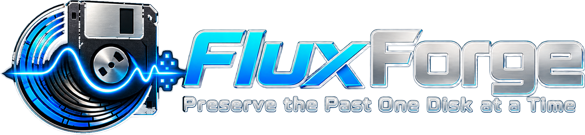

  

# FluxForge: Greaseweazle GUI for Windows for floppy disk imaging, flux preservation and recovery

**FluxForge is a free Windows desktop app for backing up, preserving and writing floppy disks with a
[Greaseweazle](https://github.com/keirf/greaseweazle) USB floppy controller.** Read Amiga, Atari ST,
IBM PC and Commodore 64 disks to ADF, ST, IMG and D64 images, capture genuine raw flux to SCP for
long-term preservation, and write images back to real floppies, all without opening a terminal.

FluxForge is a modern graphical front end for the official Greaseweazle host tools (`gw.exe`). It
installs and updates those tools for you, detects your board, shows a live track map while it works,
and tells you the truth about every disk: what was recovered, what wasn't, and why.

> FluxForge is an independent project and is not affiliated with the Greaseweazle project.
> Version 1.0, tested on a Greaseweazle V4.1 with a 3.5" PC floppy drive.

## Why FluxForge?

- **No command line.** One-click, user-approved install of the official Greaseweazle host tools,
  with no Python, no PATH editing and no administrator rights.
- **Preservation first.** Raw flux captures always use `--raw`, so the SCP file holds what the disk
  actually contains, not a "cleaned up" regeneration.
- **Honest results.** A read is only marked *Succeeded* when every sector is proven decoded. Worn
  disks show as *Partial* with exactly which tracks failed; a write only counts once it is verified.
- **Catches the wrong format.** If a disk holds sectors your chosen format doesn't define (such as
  an Atari ST 800K, 10-sector disk read as 720K), FluxForge says so and suggests the right format,
  instead of silently dropping data.
- **Check a disk against an image.** Verify reads a disk and compares every sector with an image,
  and tells apart sectors that differ from sectors the drive couldn't read.
- **A catalogue of your collection.** Every disk you read lands in the Library with its SHA-256
  fingerprints, where it came from and how it went, ready to search, tag and re-check.
- **Recover without touching the disk again.** Decode any saved raw capture into a sector image with
  a different format in Image Studio. Fragile disks only need to be read once.

## Screenshots

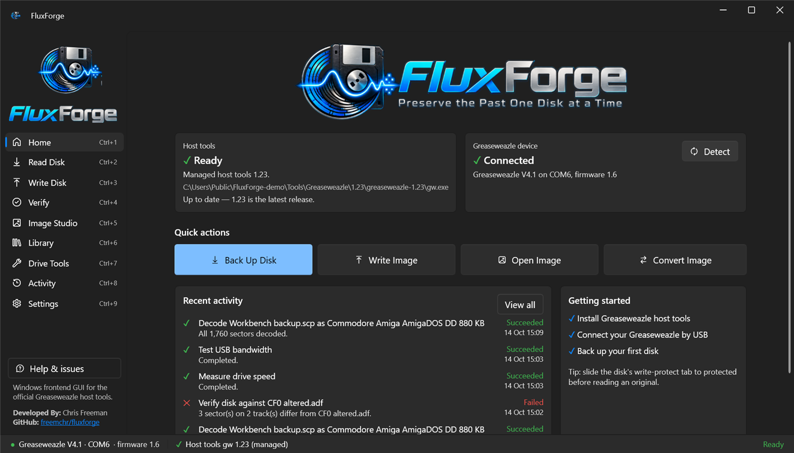

Every feature below has its own screenshot, all taken from real runs on a Greaseweazle V4.1.

## Features

### Read floppy disks (backup and preservation)
- **Preservation capture:** raw flux to `.scp`, with an optional decode check of the format while reading.
- **Sector images:** Amiga `.adf`, Atari ST `.st`, IBM PC `.img`, Commodore 64 `.d64`.
- **Live track map** for both sides of the disk, with the current track animated, plus retries,
  missing sectors and per-track detail.
- **SHA-256 fingerprint** of every image, and a full job log with the exact `gw` command and output.
- **Never overwrites a file.** Cancelled or failed reads are kept and clearly labelled `(INCOMPLETE)`.

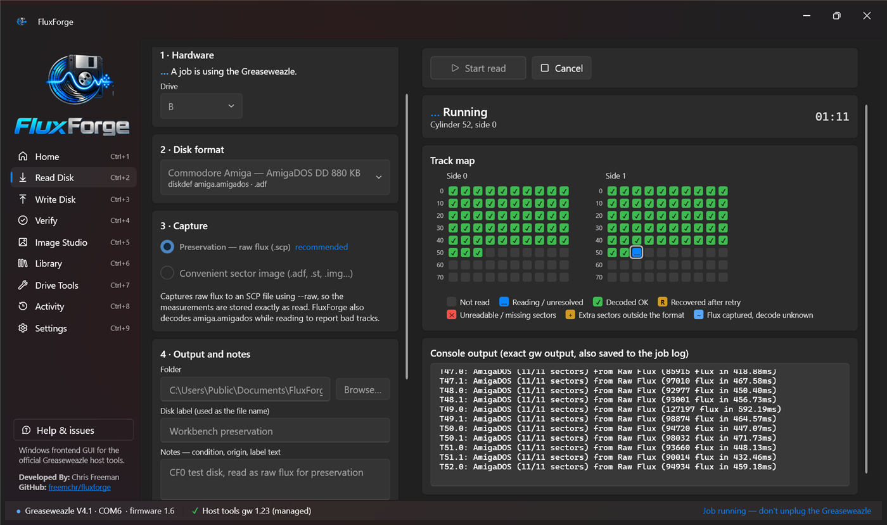

### Write disk images to floppy
- Guarded write flow: choose the format explicitly for ambiguous images, tick an overwrite
  acknowledgement, then confirm.
- Verification is on by default, and the track map animates as each track is written and verified.
- Interrupted writes are reported as "disk state unknown", never as success.

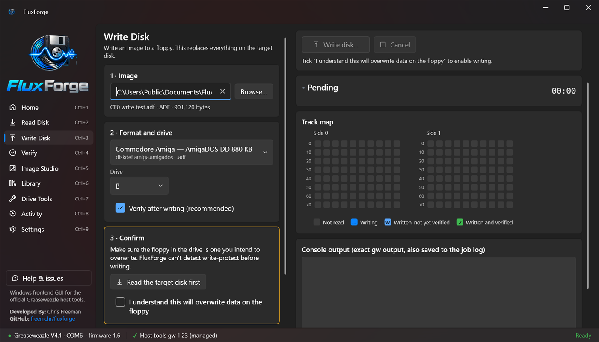

### Verify a disk against an image
- Reads the disk and compares it **sector by sector** with an `.adf` / `.st` / `.img` / `.d64` image,
  or with a raw `.scp` capture (decoded with your chosen format first).
- The track map marks each track as matching, different, unreadable, or not comparable because the
  image itself has no data there (sectors that were unreadable when the image was made).
- Lists every problem sector by cylinder, side and sector number. Read only: nothing is written to
  the disk, and the readback is deleted once compared.
- One click from the Write result: "Verify against this image".

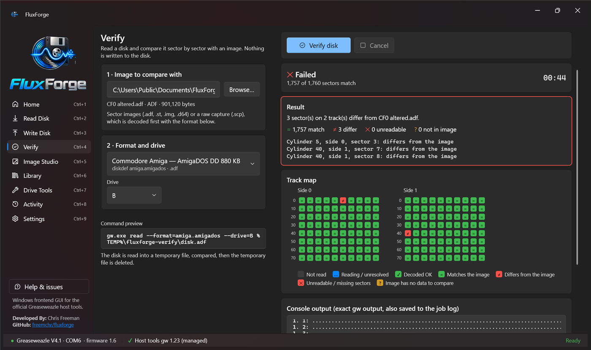

### Library: catalogue your disks
- Every successful read and decode is **added automatically**, with the job that made it (date,
  result, format). A decode joins the disk its raw capture came from. Existing history is imported
  the first time you open the Library.
- Give each disk a title, system, **condition** (good, worn, damaged), **tags** and notes, and
  search across all of them, plus file names and SHA-256 fingerprints.
- **Check files** re-hashes images and tells you if one has changed or gone missing since it was
  catalogued. Verify results are recorded against the image they were compared with.
- Add images you already have. A capture and an image with the same name in the same folder are
  kept together as one disk.
- One click to verify a disk against an image, write it, or decode a capture in Image Studio.
- Images stay where you saved them; the Library (a local SQLite file) only stores paths, hashes and
  your notes. Removing an entry never deletes a file.

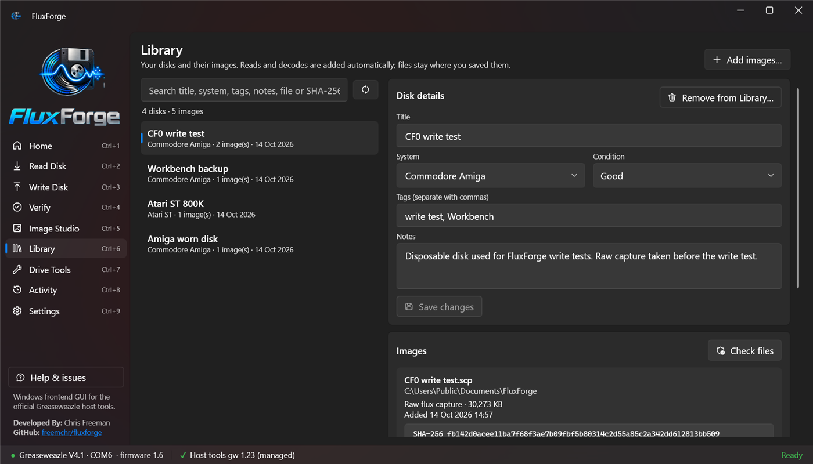

### Image Studio: decode raw flux captures
- Turn an existing `.scp` flux capture into an `.adf` / `.st` / `.img` / `.d64` image with any
  supported format.
- One-click "Decode as …" when FluxForge detects that a different format fits the capture better.

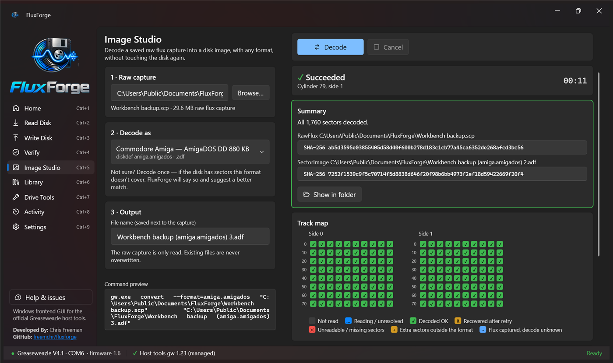

### Greaseweazle host tools manager
- Installs the official Windows release from GitHub after you approve it, with HTTPS-only download,
  digest check, safe ZIP extraction and a self-test.
- **Version management:** a daily update check that always asks first, "skip this version", and
  installing or switching to **older Greaseweazle versions** if you depend on one.
- Use your own existing `gw.exe` instead, or import a downloaded ZIP offline.

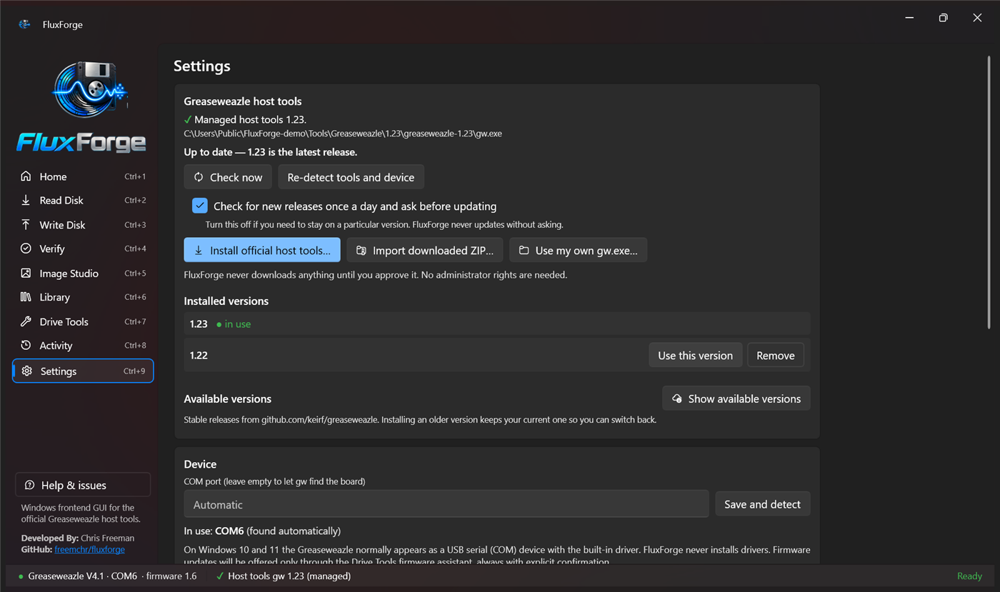

### Drive Tools
- **Drive speed check** (RPM) with a plain-language health verdict.
- **USB bandwidth test** between the PC and the Greaseweazle.
- Seek the heads to any cylinder, reset the board, and view the drive timing settings.
- **Head cleaning** with a cleaning disk, and **disk erase**, both behind clear confirmations.
- **Firmware assistant:** shows the board's firmware next to the latest official release and updates
  it with `gw update`, pinned to the version you were shown. It needs a typed confirmation, can't be
  interrupted once started, confirms the new version with the board afterwards, and links the
  official recovery guide. The bootloader is never touched.
- Every tool run is recorded in Activity.

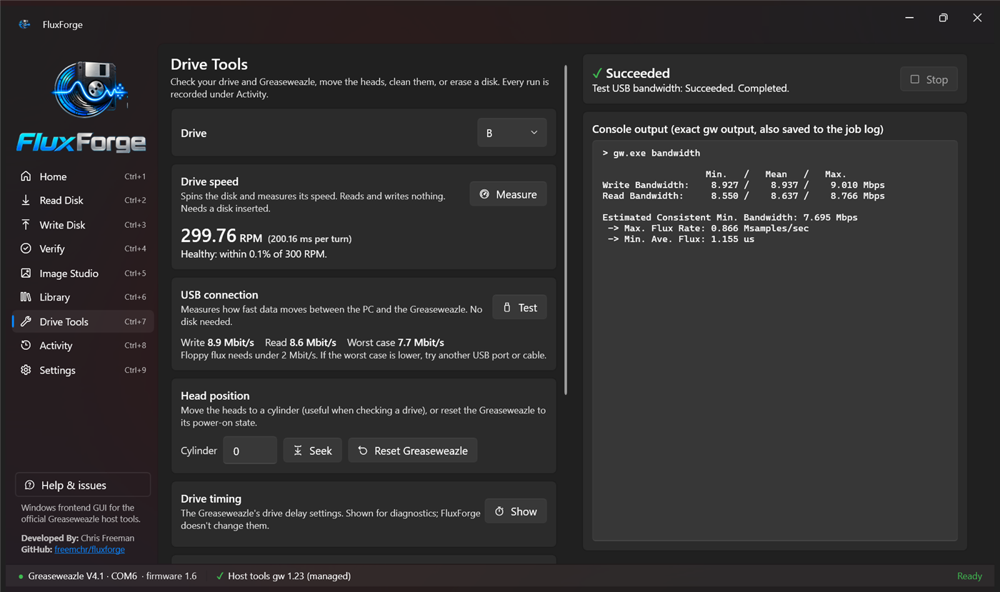

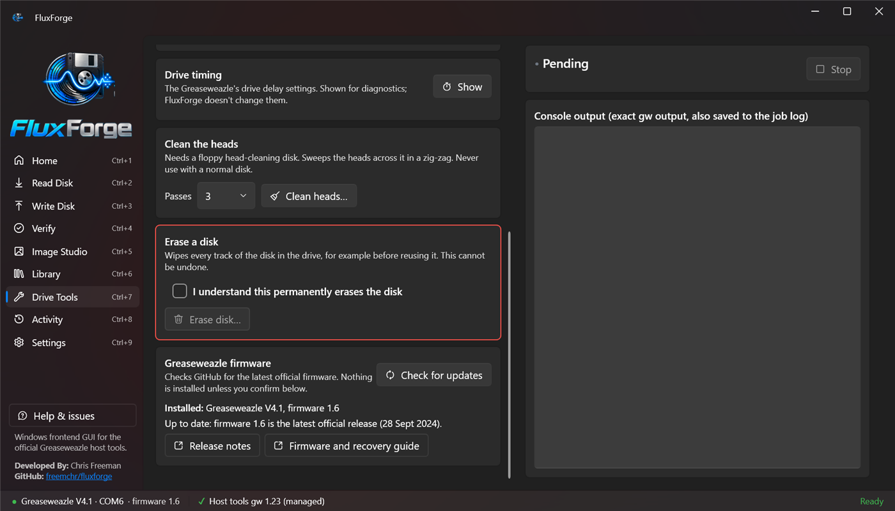

### Device and diagnostics
- Shows host tools, device and firmware as separate statuses (for example "Greaseweazle V4.1 on COM6,
  firmware 1.6").
- Plain-language help for common hardware errors, such as "Track 0 not found" (a straight cable
  usually means drive **B**).
- Activity history with searchable jobs and exportable text reports (with optional path redaction).

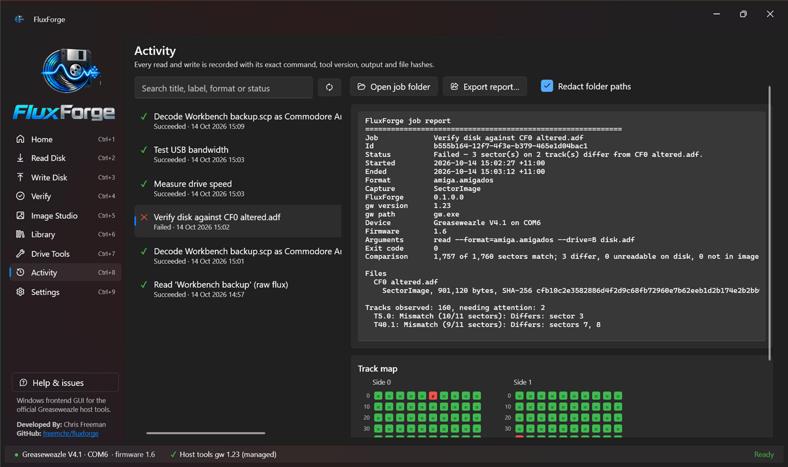

## Supported disk formats

| System | Formats (Greaseweazle diskdef) | Image |
|---|---|---|
| Commodore Amiga | AmigaDOS DD 880 KB (`amiga.amigados`) | `.adf` |
| Atari ST | 360 KB, 720 KB, 800 KB (10 sectors), 880 KB (11 sectors) (`atarist.*`) | `.st` |
| IBM PC / MS-DOS | 720 KB DD, 1.44 MB HD (`ibm.720`, `ibm.1440`) | `.img` |
| Commodore 64 | 1541 (`commodore.1541`) | `.d64` |
| Any disk | Raw flux, no decoding | `.scp` |

More of Greaseweazle's 150+ disk definitions (Apple II, Acorn, Amstrad, MSX, PC-98 and others) are
planned. Copy-protected disks should be captured as raw flux (`.scp`).

## Requirements

- Windows 10 (22H2) or Windows 11, 64-bit
- A [Greaseweazle](https://github.com/keirf/greaseweazle/wiki) board (V4/V4.1 tested) and a floppy
  drive. A standard 3.5" PC drive reads Amiga and Atari ST DD disks
- The Greaseweazle host tools, which FluxForge installs for you

## Download and install

1. Download **FluxForge.Desktop-win-Setup.exe** from the [latest release](https://github.com/freemchr/fluxforge/releases/latest).
2. Run it. FluxForge installs just for your Windows user (no administrator rights needed) and adds
   a Start menu shortcut. Prefer not to install? Use the **Portable** zip from the same page.
3. FluxForge keeps itself up to date: Settings → About → **Check for FluxForge updates**.

> Windows may show a SmartScreen warning for new releases while the app builds its reputation.
> Choose **More info → Run anyway**. Uninstalling FluxForge keeps your disk images, settings and history.

## Getting started

1. Run FluxForge. On first launch, choose **Install official host tools…**, review the release and approve it.
2. Connect your Greaseweazle by USB. FluxForge detects the board and firmware.
3. Click **Back Up Disk**, pick the disk format, and choose **Preservation (raw flux)** for anything
   irreplaceable. If reads fail with "Track 0 not found", set the drive to **B**.

## FAQ

**Is FluxForge a replacement for Greaseweazle?**
No. FluxForge drives the official Greaseweazle host tools (`gw.exe`) and adds a user interface,
safety checks, a track map, job history and image management on top.

**Raw flux (SCP) or sector image (ADF/ST)?**
For preservation, capture raw flux: it keeps everything on the disk, including copy protection and
timing. Sector images are smaller and work directly in emulators such as WinUAE, Hatari and VICE, and
on Gotek / FlashFloppy. FluxForge can make a sector image from a raw capture later, without the disk.

**My Atari ST disk "struggles" in other tools.**
It may be a 10-sector (800K) or 11-sector (880K) disk. FluxForge detects this and suggests the matching format.

**Can I use an older Greaseweazle version?**
Yes. Settings → Host tools versions lists every stable release; install or switch between them.

## Contributing

Developers: see [CONTRIBUTING.md](CONTRIBUTING.md) for building from source, testing without hardware
and the project layout.

## Support

Found a bug or have an idea? [Open an issue](https://github.com/freemchr/fluxforge/issues/new/choose).
Tried FluxForge with your own Greaseweazle? A quick [hardware test report](https://github.com/freemchr/fluxforge/issues/new?template=hardware_test_report.yml) helps a lot, even if everything worked.
When reporting a problem, attach the job report from **Activity → Export report**.
If FluxForge saved one of your disks, you can [buy me a coffee](https://buymeacoffee.com/cjf077) ☕

## License

FluxForge is free and open source under the [MIT License](LICENSE). It is provided as is, without
warranty: always keep a raw capture of disks that matter before writing to them. Greaseweazle and the
other components FluxForge uses keep their own licenses; see [THIRD-PARTY-NOTICES.md](THIRD-PARTY-NOTICES.md).
